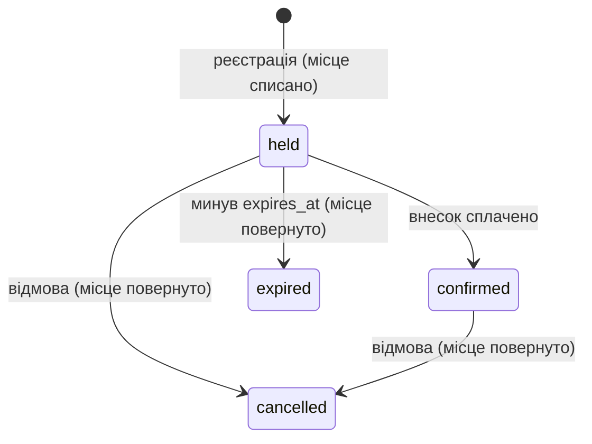
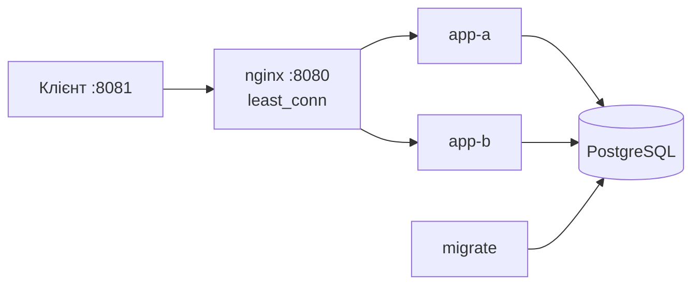

# C24 Ігрові турніри – проєкт курсу «Обмін даними у Web-застосунках»

## 1. Курс і тема

Курс «Обмін даними у Web-застосунках», тема C24 «Ігрові турніри».

Команда: `<Литвинов Ю. О. ІТІНФ-23-1>`, `<Константінов О. К. ІТІНФ-23-1>`, `<Алєксандрова Л. А. ІТІНФ-23-1>`, `<Богдан Юрій ІТІНФ-23-1>`.

## 2. Проєкт (О1.1)

Гравці реєструються на турнір з обмеженою кількістю місць, організатор фіксує результати матчів. Головна складність: реєстрація відкривається, і місця розбирають за хвилину.

**Ролі:** гравець (`user`) реєструється на турнір і бачить свої реєстрації; організатор (`staff`) фіксує результати матчів. До ЛР3 користувач передається заголовком `X-User-Id`.

**Головна операція:** `POST /v1/registrations` - реєстрація з утриманням місця.

**Сутності:** `tournament` (турнір, місця `slots` і вільні `available`, внесок), `registration` (гравець + турнір + нікнейм), `match` (пара реєстрацій, переможець), `app_user` (гравець або організатор).

**Стани реєстрації:**



Матч: `scheduled → finished`, результат фіксується один раз.

**Інваріанти:**

1. Учасників не більше, ніж місць: `0 ≤ available ≤ slots`.
2. Один гравець - одна активна (`held` / `confirmed`) реєстрація на турнір; нікнейм унікальний серед активних реєстрацій турніру.
3. Результат матчу фіксується один раз.
4. Власник реєстрації - користувач із `X-User-Id`, а не з тіла запиту.

**Параметри (навчальні припущення):** 64 місця (тестовий турнір CS2 - 2 місця), внесок 5000 копійок = 50,00 UAH (`bigint` + валюта), утримання місця 15 хвилин, нікнейм 3–32 символи, реєстрація до `starts_at`. Моменти - `timestamptz`, назва часової зони турніру - окреме поле `time_zone`.

## 3. Архітектура



Шлях головної операції - одна транзакція PostgreSQL:

1. `INSERT INTO idempotency_key … ON CONFLICT …` - ключ ідемпотентності (користувач, операція, ключ, відбиток тіла). Ключ уже є: те саме тіло → збережена відповідь, інше тіло → 422, запит із цим ключем ще виконується → 409.
2. `UPDATE tournament SET available = available - 1 WHERE id = … AND registration_open AND available > 0 AND starts_at > now() RETURNING id` - перевірка й списання місця однією атомарною дією.
3. Рядка немає: турніру немає → 404, інакше місць немає → 409.
4. `INSERT INTO registration … 'held'`; порушення унікальності → 409, невідомий користувач → 422. Помилка відкочує предметну зміну до точки збереження, місце повертається.
5. `UPDATE idempotency_key SET state = 'done', …` зберігає код і тіло відповіді; COMMIT, лише після нього - `201` + `Location` або відмова.

Решта сервісів комплекту (Kafka, Redis, Keycloak, шлюзи, симулятор, Prometheus, Grafana) призначені для ЛР4–ЛР6 і поки не використовуються.

## 4. Структура репозиторію

| Шлях | Призначення |
| --- | --- |
| `compose.yaml`, `.env.example` | усі сервіси комплекту й параметри |
| `migrations/001_tournaments.sql`, `002_idempotency.sql` | схема: турніри, реєстрації, матчі; ключі ідемпотентності |
| `migrations/900_seed.sql`, `901_race_seed.sql` | тестові дані; турнір і 200 гравців для досліду гонки |
| `server/app/registrations.py` | маршрути турнірів і реєстрацій |
| `server/app/idempotency.py` | механізм ідемпотентності: ключ, відбиток, збережена відповідь, прибирання |
| `server/app/main.py` | підключення маршрутів і CORS для клієнта |
| `client/index.html`, `client/api.js` | вебклієнт |
| `openapi.yaml`, `redocly.yaml` | контракт API і налаштування лінтера |
| `checks.yaml` | налаштування засобу перевірки викладача |
| `tools/check-lab1.sh`, `tools/check-lab2.sh` | перевірка пунктів ЛР1 і ЛР2 однією командою |
| `tools/race.py` | дослід О2.1: одночасні реєстрації через обидва екземпляри |

## 5. Збирання й запуск

Потрібен Docker Desktop із Compose v2 (від 6 ГБ пам'яті для Docker). Команди - з кореня репозиторію, у Git Bash.

```bash
cp .env.example .env
docker compose up -d --build
```

Міграції застосовує сервіс `migrate`. Повне скидання бази - `docker compose down -v`.

Клієнт - окремо, не в Compose:

```bash
py -m http.server 8081 --bind 127.0.0.1 --directory client
```

Відкрити http://localhost:8081.

Тестові дані: гравці `u-player1`, `u-player2`, `u-player3` (логіни `player1`…`player3`, пароль `player-pass`), організатор `u-organizer` (`organizer` / `organizer-pass`); турніри `t-dota` (64 місця, 50,00 UAH) і `t-cs2` (2 місця). Для досліду гонки: турнір `t-race` (64 місця) і гравці `u-race001`…`u-race200`.

## 6. Лабораторні роботи

### ЛР1. Контракт, модель і перша операція

| Пункт | Де реалізовано | Перевірка та свідчення |
| --- | --- | --- |
| О1.1 Модель | цей README, розділ 2 | діаграма станів, інваріанти, параметри |
| О1.2 Схема БД | `migrations/001_tournaments.sql`, `900_seed.sql` | PK/FK/NOT NULL/CHECK/UNIQUE; `docker compose exec postgres psql -U app -d app -c "UPDATE tournament SET available = -1"` → `violates check constraint` |
| О1.3 Контракт | `openapi.yaml` | `npx @redocly/cli@latest lint openapi.yaml` → `Your API description is valid`; приклади `normal`, `scarce`, `missing`; помилки - Problem Details |
| О1.4 Головна операція | `server/app/registrations.py` | `bash tools/check-lab1.sh`: 201 + Location, 400, 404, 409, 422, ідентифікатори - рядки |
| О1.7 Клієнт | `client/index.html` | вибір гравця й турніру, реєстрація, показ результату або Problem Details |

### ЛР2. Конкуренція та повторення запитів

| Пункт | Де реалізовано | Перевірка та свідчення |
| --- | --- | --- |
| О2.1 Інваріант за одночасних запитів | `server/app/registrations.py` (умовний `UPDATE`), `tools/race.py` | `py tools/race.py`: 200 одночасних запитів на 64 місця через `app-a` і `app-b` → `201 - 64`, `409 - 136`, `available = 0`, активних реєстрацій 64 |
| О2.2 Механізм ідемпотентності | `server/app/idempotency.py`, `migrations/002_idempotency.sql` | `bash tools/check-lab2.sh`: немає ключа → 400, повтор через інший екземпляр → та сама відповідь, інше тіло → 422, ключ ще обробляється → 409, прострочені ключі прибрано |

**О2.1, вибір способу.** Інваріант тримає атомарний умовний запис: одна інструкція `UPDATE … WHERE available > 0` і перевіряє залишок, і списує місце. Блокування рядка турніру бере сама інструкція; одночасний запит з іншого екземпляра чекає на COMMIT і перевіряє умову вже на новому значенні `available`. Окремий `SELECT … FOR UPDATE` дав би той самий результат за два звернення до бази замість одного. Серіалізовна транзакція потребувала б повторів після помилок серіалізації, а під час розпродажу місць їх було б багато. `CHECK (available BETWEEN 0 AND slots)` лишається другим рубежем. Локальний м'ютекс не підходить, бо екземплярів два.

**О2.2, як працює.** Заголовок `Idempotency-Key` (8–128 символів) обов'язковий для `POST /v1/registrations`, без нього 400. Рядок `idempotency_key` (користувач, операція, ключ, відбиток тіла, стан, код, `Location`, відповідь, строк 24 години) вставляється й завершується в одній транзакції з предметною зміною, тому ключ без реєстрації або реєстрація без ключа неможливі. Наявність ключа не перевіряється окремим `SELECT`: рішення приймає `INSERT … ON CONFLICT` за первинним ключем. Відбиток - SHA-256 від JSON перевіреного тіла з відсортованими ключами, перестановка полів його не змінює. Зберігаються й відмови (404, 409): повтор повертає ту саму відмову. Якщо перший запит із цим ключем ще не зафіксовано, другий чекає до 500 мс (`lock_timeout`) і отримує 409 з `Retry-After: 1`. Прострочені ключі кожен екземпляр прибирає раз на 30 с порціями по 500 рядків (`FOR UPDATE SKIP LOCKED`).

## 7. Досліди

| Дослід | Команда | Що видно |
| --- | --- | --- |
| Коди відповідей головної операції | `bash tools/check-lab1.sh` | 13 перевірок `OK`, «Усі перевірки ЛР1 пройдено» |
| Нестача місць | той самий скрипт, турнір `t-cs2` на 2 місця, третій гравець | `409 No free slots`, `available` = 0 |
| О2.1: 200 гравців на 64 місця | `py tools/race.py` | `201 - 64`, `409 - 136` (усі `no-free-slots`), 201 видали обидва екземпляри, `available = 0`, 64 активні реєстрації, «ІНВАРІАНТ ЗБЕРЕЖЕНО» |
| О2.2: повтор запиту | `bash tools/check-lab2.sh` | повтор через `app-b` повертає той самий `id` і `Location` із заголовком `Idempotent-Replayed: true`, у базі одна реєстрація, «Усі перевірки ЛР2 пройдено» |

Середовище дослідів: AMD Ryzen 7 9800X3D, Docker Desktop 29.8, Windows 11. Для `tools/race.py` потрібен Python 3 (лише стандартна бібліотека).

## 8. Межі гарантій

Інваріант «учасників не більше, ніж місць» тримають умовний `UPDATE` в одній транзакції та `CHECK (available BETWEEN 0 AND slots)`. Повтор із тим самим ключем не повторює предметну зміну, поки ключ зберігається (24 години); після цього той самий ключ вважається новим. Керована відмова між COMMIT і відповіддю (О2.3) та повтори в клієнті (О2.4) до виконаних пунктів не входять. Завершення строку `held` - у ЛР4.

## 9. Внесок учасників

| Учасник | Реалізовані пункти |
| --- | --- |
| Литвинов Ю. О. | репозиторій на основі комплекту, О1.1 модель області, README. ЛР2: О2.2 механізм ідемпотентності, `tools/check-lab2.sh` |
| Константінов О. К. | О1.2 схема бази даних і тестові дані. ЛР2: О2.1 дослід одночасних запитів (`tools/race.py`, `901_race_seed.sql`), обґрунтування способу |
| Богдан Юрій | О1.4 головна операція, скрипт перевірки `tools/check-lab1.sh` |
| Алєксандрова Л. А. | О1.3 контракт API, `checks.yaml`, О1.7 клієнт |

### Використані готові рішення й бібліотеки

| Що | Для чого | Де |
| --- | --- | --- |
| Комплект курсу (каркас викладача) | `compose.yaml`, nginx, міграції, `server/app` (журнал, X-Request-ID, Problem Details), `client/api.js` | увесь репозиторій, крім файлів із розділу 4 |
| FastAPI | HTTP-маршрути й перевірка вхідних даних | `server/app/registrations.py` |
| Psycopg | транзакція головної операції, точка збереження | `server/app/registrations.py`, `server/app/idempotency.py` |
