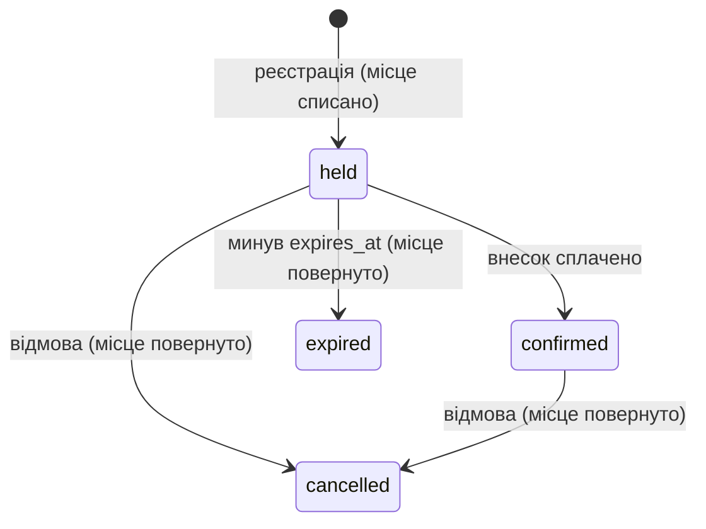
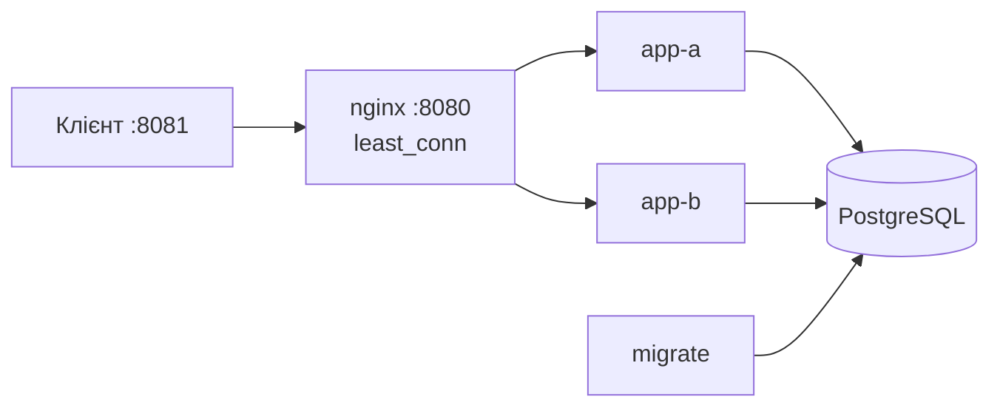

# C24 Ігрові турніри – проєкт курсу «Обмін даними у Web-застосунках»

## 1. Курс і тема

Курс «Обмін даними у Web-застосунках», тема C24 «Ігрові турніри».

Команда: `<Литвинов Ю. О. ІТІНФ-23-1>`, `<Константінов О. К. ІТІНФ-23-1>`, `<Алєксандрова Л. А. ІТІНФ-23-1>`, `<Богдан Юрій ІТІНФ-23-1>`.

## 2. Проєкт (О1.1)

Гравці реєструються на турнір з обмеженою кількістю місць, організатор фіксує результати матчів. Головна складність: реєстрація відкривається, і місця розбирають за хвилину.

**Ролі:** гравець (`user`) реєструється на турнір і бачить свої реєстрації; організатор (`staff`) фіксує результати матчів. До ЛР3 користувач передається заголовком `X-User-Id`.

**Головна операція:** `POST /v1/registrations` — реєстрація з утриманням місця.

**Сутності:** `tournament` (турнір, місця `slots` і вільні `available`, внесок), `registration` (гравець + турнір + нікнейм), `match` (пара реєстрацій, переможець), `app_user` (гравець або організатор).

**Стани реєстрації:**



Матч: `scheduled → finished`, результат фіксується один раз.

**Інваріанти:**

1. Учасників не більше, ніж місць: `0 ≤ available ≤ slots`.
2. Один гравець — одна активна (`held` / `confirmed`) реєстрація на турнір; нікнейм унікальний серед активних реєстрацій турніру.
3. Результат матчу фіксується один раз.
4. Власник реєстрації — користувач із `X-User-Id`, а не з тіла запиту.

**Параметри (навчальні припущення):** 64 місця (тестовий турнір CS2 — 2 місця), внесок 5000 копійок = 50,00 UAH (`bigint` + валюта), утримання місця 15 хвилин, нікнейм 3–32 символи, реєстрація до `starts_at`. Моменти — `timestamptz`, назва часової зони турніру — окреме поле `time_zone`.

## 3. Архітектура



Шлях головної операції — одна транзакція PostgreSQL:

1. `UPDATE tournament SET available = available - 1 WHERE id = … AND registration_open AND available > 0 AND starts_at > now() RETURNING id` — перевірка й списання місця однією атомарною дією.
2. Рядка немає: турніру немає → 404, інакше місць немає → 409.
3. `INSERT INTO registration … 'held'`; порушення унікальності → 409, невідомий користувач → 422. Будь-яка помилка — ROLLBACK, місце повертається.
4. COMMIT, лише після нього — `201` + `Location`.

Решта сервісів комплекту (Kafka, Redis, Keycloak, шлюзи, симулятор, Prometheus, Grafana) призначені для ЛР2–ЛР6 і в ЛР1 не використовуються.

## 4. Структура репозиторію

| Шлях | Призначення |
| --- | --- |
| `compose.yaml`, `.env.example` | усі сервіси комплекту й параметри |
| `migrations/001_tournaments.sql`, `migrations/900_seed.sql` | схема й тестові дані |
| `server/app/registrations.py` | маршрути турнірів і реєстрацій |
| `server/app/main.py` | підключення маршрутів і CORS для клієнта |
| `client/index.html`, `client/api.js` | вебклієнт |
| `openapi.yaml`, `redocly.yaml` | контракт API і налаштування лінтера |
| `checks.yaml` | налаштування засобу перевірки викладача |
| `tools/check-lab1.sh` | перевірка пунктів ЛР1 однією командою |

## 5. Збирання й запуск

Потрібен Docker Desktop із Compose v2 (від 6 ГБ пам'яті для Docker). Команди — з кореня репозиторію, у Git Bash.

```bash
cp .env.example .env
docker compose up -d --build
```

Міграції застосовує сервіс `migrate`. Повне скидання бази — `docker compose down -v`.

Клієнт — окремо, не в Compose:

```bash
py -m http.server 8081 --bind 127.0.0.1 --directory client
```

Відкрити http://localhost:8081.

Тестові дані: гравці `u-player1`, `u-player2`, `u-player3` (логіни `player1`…`player3`, пароль `player-pass`), організатор `u-organizer` (`organizer` / `organizer-pass`); турніри `t-dota` (64 місця, 50,00 UAH) і `t-cs2` (2 місця).

## 6. Лабораторні роботи

### ЛР1. Контракт, модель і перша операція

| Пункт | Де реалізовано | Перевірка та свідчення |
| --- | --- | --- |
| О1.1 Модель | цей README, розділ 2 | діаграма станів, інваріанти, параметри |
| О1.2 Схема БД | `migrations/001_tournaments.sql`, `900_seed.sql` | PK/FK/NOT NULL/CHECK/UNIQUE; `docker compose exec postgres psql -U app -d app -c "UPDATE tournament SET available = -1"` → `violates check constraint` |
| О1.3 Контракт | `openapi.yaml` | `npx @redocly/cli@latest lint openapi.yaml` → `Your API description is valid`; приклади `normal`, `scarce`, `missing`; помилки — Problem Details |
| О1.4 Головна операція | `server/app/registrations.py` | `bash tools/check-lab1.sh`: 201 + Location, 400, 404, 409, 422, ідентифікатори — рядки |
| О1.7 Клієнт | `client/index.html` | вибір гравця й турніру, реєстрація, показ результату або Problem Details |

## 7. Досліди

| Дослід | Команда | Що видно |
| --- | --- | --- |
| Коди відповідей головної операції | `bash tools/check-lab1.sh` | 13 перевірок `OK`, «Усі перевірки ЛР1 пройдено» |
| Нестача місць | той самий скрипт, турнір `t-cs2` на 2 місця, третій гравець | `409 No free slots`, `available` = 0 |

## 8. Межі гарантій

Інваріант «учасників не більше, ніж місць» тримають умовний `UPDATE` в одній транзакції та `CHECK (available BETWEEN 0 AND slots)`. Повтор запиту після втраченої відповіді й одночасні запити досліджуються в ЛР2; завершення строку `held` — у ЛР4.

## 9. Внесок учасників

| Учасник | Реалізовані пункти |
| --- | --- |
| Литвинов Ю. О. | репозиторій на основі комплекту, О1.1 модель області, README |
| Константінов О. К. | О1.2 схема бази даних і тестові дані |
| Богдан Юрій | О1.4 головна операція, скрипт перевірки `tools/check-lab1.sh` |
| Алєксандрова Л. А. | О1.3 контракт API, `checks.yaml`, О1.7 клієнт |

### Використані готові рішення й бібліотеки

| Що | Для чого | Де |
| --- | --- | --- |
| Комплект курсу (каркас викладача) | `compose.yaml`, nginx, міграції, `server/app` (журнал, X-Request-ID, Problem Details), `client/api.js` | увесь репозиторій, крім файлів із розділу 4 |
| FastAPI | HTTP-маршрути й перевірка вхідних даних | `server/app/registrations.py` |
| Psycopg | транзакція головної операції | `server/app/registrations.py` |
